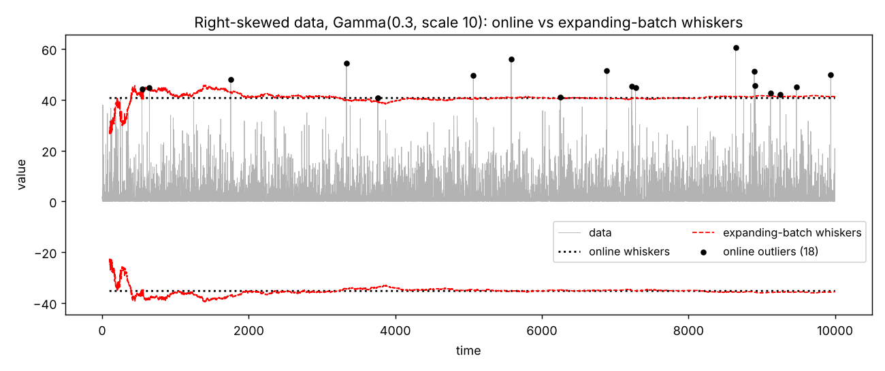

# Online-Boxplot

Outlier detection for data streams, based on the boxplot. It keeps a small
histogram instead of the data, so memory stays constant, and it handles skewed
data without flagging a large share of ordinary points.

This package is a clean re-implementation of the method in:

> Mazarei, A., Sousa, R., Mendes-Moreira, J., Molchanov, S., Ferreira, H. M.
> **Online boxplot derived outlier detection.**
> *International Journal of Data Science and Analytics* 19, 83–97 (2025).
> [doi:10.1007/s41060-024-00559-0](https://doi.org/10.1007/s41060-024-00559-0) (open access)

It also contains the batch boxplot variants from the paper, so you can compare
them on your own data.



## Install

```bash
git clone https://github.com/ArefehMazarei/Online-Boxplot.git
cd Online-Boxplot
pip install .              # numpy only
pip install ".[calibrate]" # adds scipy, for fitting the whisker constants
```

Python 3.10 or newer.

## Quick start

```python
import numpy as np
from onlineboxplot import detect

series = np.random.default_rng(0).gamma(0.3, 10, 5000)   # right-skewed
series[[2000, 3500]] = [90, 120]                          # two spikes

for o in detect(series, warmup=200):
    print(o.index, o.value, o.score)
```

The first `warmup` points build the first histogram. Later points are tested
one at a time, as if they arrived in a stream. Each outlier comes back with its
index, value, the whiskers that were in force, and a score: the distance beyond
the nearest whisker in units of the IQR.

For a true stream, use the class directly:

```python
from onlineboxplot import OnlineBoxplot

det = OnlineBoxplot().fit(first_window)   # first_window: a list or array
for value in stream:
    if det.update(value):                 # True = outlier
        print("outlier:", value, "score", det.score(value))
```

## Variants

`detect(values, mode=..., rule=...)` covers the methods in the paper:

| rule | whiskers | online | expanding | batch |
|---|---|---|---|---|
| `tukey` | Q1 − w·IQR, Q3 + w·IQR (Eq. 1) | ✓ | ✓ | ✓ |
| `siqr` | semi-interquartile ranges, Kimber (Eq. 2) | ✓ | ✓ | ✓ |
| `ratio` | ratio-skewed boxplot, Walker et al. (Eq. 6–8) | ✓ | ✓ | ✓ |
| `qsm` | exponential model on the quartile skewness, **the paper's method** (Eq. 10) | ✓ | ✓ | ✓ |
| `adjusted` | adjusted boxplot with the medcouple, Hubert and Vandervieren (Eq. 5) | – | – | ✓ |

Modes:

- **`online`**: quartiles from a histogram with bounded size. The data is not stored.
- **`batch`**: exact quartiles of the whole series, one fixed set of whiskers. "What if I could see everything."
- **`expanding`**: exact quartiles of all data seen before each point, recomputed every step. "What if I stored everything so far." It sees the same data as the online method at each step, which makes it the fairest comparison. It is slow (cost grows with n²), so use it for evaluation only.

`available_methods()` lists every valid combination.

## How well does it work?

`examples/reproduce_simulation.py` runs the paper's simulation study (seed 0,
10,000 points, first window of 100 points, bins one standard deviation wide,
Chebyshev k = 55). The online method is compared with the two batch references:

| Data | Tukey flags | Online flags | Reference | Precision | Recall | F1 |
|---|---|---|---|---|---|---|
| Right-skewed, Γ(0.3, scale 10) | 11.1% | 0.18% (18 points) | whole stream | 0.89 | 1.00 | 0.94 |
| | | | expanding | 1.00 | 0.82 | 0.90 |
| Left-skewed, −Γ(0.4, scale 5) | 9.3% | 0.21% (21 points) | whole stream | 0.86 | 1.00 | 0.92 |
| | | | expanding | 0.86 | 0.72 | 0.78 |

How to read this:

- On strongly skewed data, Tukey's boxplot flags about a tenth of all points. The online boxplot flags only the far tail.
- The online method follows the batch result closely, with a small, constant-memory histogram.
- The choice of batch reference changes the scores, mostly the recall. Against `expanding`, the online method flags somewhat fewer points than a batch method that has stored all the past data. The paper's Table 1 compares against the whole-stream reference.
- Precision and recall are measured against the batch result, not against labelled anomalies.
- The real-world (IT metrics) results of the paper use private data and are not reproduced here.

The constants `a` and `b` in this table are the values the paper's fitting
procedure returns for these series (see below).

## Choices you can make

- **`n_bins`**: `"std"` (default) uses bins one standard deviation wide, as in the paper's simulation study. An integer such as `150` gives finer bins. Finer bins give more precise quartiles, but results then depend much more on the constants `a` and `b`: with the default constants, 150 bins flag about 3% of the right-skewed series above instead of 0.2%.
- **`a`, `b`** (rule `qsm`): the paper fits them per series. The defaults (−4, 0.5) are the starting point of that fit and work with the default bins. `calibrate_qsm(values)` or `detect(..., calibrate=True)` runs the fit (needs scipy). The fit only compares online whiskers with batch whiskers, so use it with `n_bins="std"`: with fine bins it can drift to extreme values that flag a large share of ordinary points. Always look at the share of flagged points on your own data.
- **`k`** (default 55): points more than `k` standard deviations from the running mean are flagged but not added to the histogram (Chebyshev bound). `k=None` switches it off.
- **`max_bins`** (default 1000): the histogram merges bins in pairs when it reaches this size. This is what keeps memory constant.

## Notes on the implementation

- When Q1, Q2 and Q3 fall into the same histogram bin, the box is widened by one bin on each side. Otherwise coarse histograms on skewed data would flag most ordinary points.
- `floor_bins` (default 1) keeps the whiskers at least one bin width away from the box. Set it to 0 to switch this off.
- NaN values are skipped: never flagged, never learned.
- The medcouple is O(n²), so for more than 4000 points a fixed-seed subsample is used.

## Limitations

- Univariate only. Each series needs its own detector.
- The histogram never forgets. If the level of a series shifts for good, the whiskers adapt slowly, and the Chebyshev bound keeps very distant points out of the histogram.
- Quartiles are only as precise as the bin width.
- The simulation study is synthetic. Precision and recall are relative to a batch method, not to labelled anomalies.
- You choose `warmup` (the length of the first window). It should be long enough to represent the series.

## Tests

```bash
pip install -e ".[dev]"
pytest
```

The tests check each whisker rule against hand-computed values, the medcouple
against statsmodels, memory bounds, NaN handling, and the numbers in the table above.

## Citation

If you use this package, please cite the paper above. 
    @article{mazarei2025online,
    title={Online boxplot derived outlier detection},
    author={Mazarei, Arefeh and Sousa, Ricardo and Mendes-Moreira, Jo{\~a}o and Molchanov, Slavo and Ferreira, Hugo Miguel},
    journal={International Journal of Data Science and Analytics},
    volume={19},
    number={1},
    pages={83--97},
    year={2025},
    publisher={Springer},
    doi={10.1007/s41060-024-00559-0}
    }

## Licence

MIT. See `LICENSE`.
